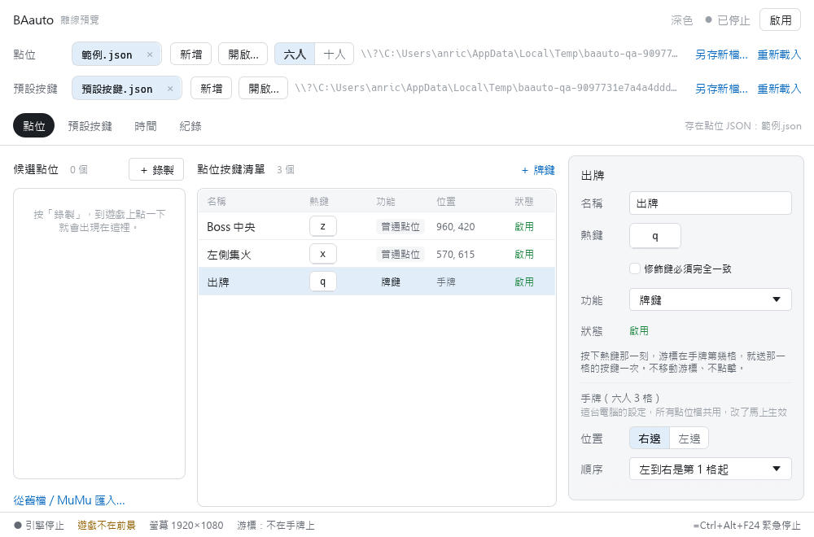
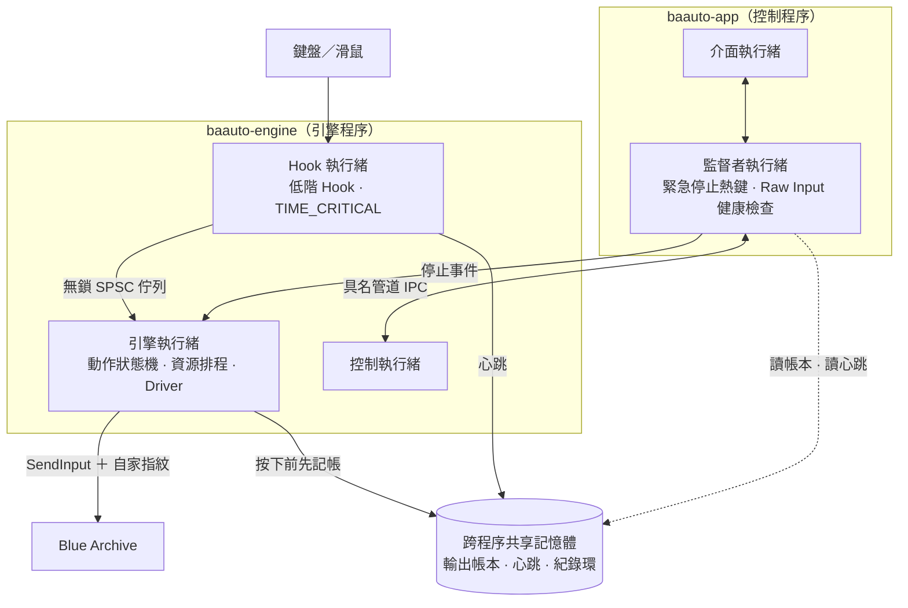

# BAauto

Blue Archive（蔚藍檔案）PC 版的按鍵輔助工具。按一個鍵就能放技能、連點、卡幀暫停、出手牌、點畫面上固定的位置。這是原本 AutoHotkey 腳本 `BAauto.ahk` 的新版，用 Rust 重寫，重點放在反應快、隨時停得下來、不卡鍵。



> **目前狀態**：預覽版 `v0.1.0-preview.3`。功能都做好了，自動測試全部通過，慢卡幀和其他預設功能已在 Windows 接收器實測。時間設定剛改成「每一步之間的間隔」、開牌剛改成按一下跑完一次，這兩項還沒在 Windows 實機重測，也還沒在真實遊戲裡長時間使用過。遇到問題請回報，說明見文末。

## 需要什麼

- Windows 10 或 11
- 遊戲用**全螢幕 16:9** 執行。不是 16:9 時，點位和手牌位置會不準，BAauto 會在畫面上提醒。

## 安裝

1. 到 [Releases 頁面](https://github.com/Sukia037/baauto-rs/releases) 下載最新的 `BAauto-<版本>-windows-x64.zip`。
2. 解壓縮到你想放的資料夾，裡面有 `baauto-app.exe`、`engine` 資料夾和這份說明。
3. 執行 `baauto-app.exe`。

只要開 `baauto-app.exe`。`engine` 資料夾裡是引擎，主程式會自己叫它，不用去開，也不要移走或刪掉。設定檔會存在 `baauto-app.exe` 旁邊，所以更新時把新版的 `baauto-app.exe` 和 `engine` 資料夾一起覆蓋過去，原本的設定都會保留。

執行檔沒有數位簽章，第一次開啟時 Windows 可能跳出「Windows 已保護您的電腦」。確認檔案是從上面的 Releases 頁面下載的，就按「其他資訊」→「仍要執行」。想核對檔案沒被動過，可以比對同一頁的 `.sha256` 檔：

```powershell
Get-FileHash .\BAauto-<版本>-windows-x64.zip -Algorithm SHA256
```

<details>
<summary>自己從原始碼建置</summary>

1. **安裝 Rust**：在 PowerShell 執行 `winget install Rustlang.Rustup`，或到 <https://rustup.rs> 下載安裝程式。安裝過程如果問要不要裝 Visual Studio，選自動安裝。裝完關掉 PowerShell 再重開一個。
2. **下載這個專案**，在專案資料夾（有 `Cargo.toml` 的那一層）開 PowerShell，執行：
   ```powershell
   cargo build --release --workspace
   ```
   第一次要幾分鐘。
3. 到 `target\release\`，把 `baauto-app.exe` 複製到你想放的資料夾，再在旁邊建一個 `engine` 資料夾，把 `baauto-engine.exe` 放進去。兩個 exe 直接放在一起也可以用。

</details>

## 快速開始

1. 打開 `baauto-app.exe`。第一次開啟會在同一個資料夾建立範例設定。
2. 打開遊戲，回到 BAauto，按右上角的 **「啟用」**。
3. 切回遊戲就能用了。例如按 `w` 放第 1 個技能，按住 `2` 會一直連點第 1 個技能。
4. 任何時候按 **`Ctrl+F9`（緊急停止）**，所有動作會立刻停下，按住的鍵也會全部放開。

BAauto 只在遊戲是前景視窗時才會動作。切到別的視窗會自動暫停，切回遊戲、手放開按鍵後就自動繼續。按過緊急停止的話，要回 BAauto 再按一次「啟用」。

## 預設按鍵

全部都能在「預設按鍵」分頁改鍵或關閉。

| 功能 | 預設熱鍵 | 做什麼 |
|---|---|---|
| 緊急停止 | `Ctrl+F9` | 停止全部動作、放開所有按鍵。只能設鍵盤組合鍵。 |
| 錄製點位 | `Ctrl+F10` | 開始錄一個點位，接著到遊戲上點一下。只能設鍵盤組合鍵。 |
| 技能 1–5 | `w` `e` `r` `t` `y` | 送出 1–5 一次。 |
| 連點 1–5 | `2` `3` `4` `5` `6` | 按住時一直重複「送出 1–5，再點一下左鍵」。 |
| 開牌 1–5 | `a` `s` `d` `f` `g` | 在暫停畫面按一下，就跑完「Esc → 1–5 → 在游標位置點左鍵 → Esc」。按住不會重複出牌。 |
| 普通暫停 | `Space` | 送出 Esc。 |
| 卡幀暫停（快） | `↓` | Esc，等 16ms，再 Esc。 |
| 卡幀暫停（慢） | `↑` | Esc，等 50ms，再 Esc。 |
| AUTO | 滑鼠側鍵（後） | 送出 a。 |
| 加速 | 滑鼠側鍵（前） | 送出 s。 |
| 滑鼠連點 | 滑鼠右鍵 | 按住時一直點左鍵。 |

每個按鍵都是按下後馬上放開。可以調的是每一步之間的間隔，在「時間」分頁：每個功能一列，寫成 `Esc →〔16〕→ Esc` 這樣，括號裡的數字（ms）直接改就好，同一列的功能共用。例如牌鍵是「數字鍵 →〔0〕→ 移到點位按下左鍵 →〔16〕→ 放開 → 游標回原位 →〔16〕→ 下一輪」，中間那個「按下到放開」太短的話，遊戲可能讀不到點擊位置。

按住熱鍵不會跟著鍵盤的自動重複一直觸發：技能、暫停、AUTO、加速、開牌按住都只算一次；連點、滑鼠連點、點位、牌鍵是按住期間持續動作。

## 點位和牌鍵

「點位」分頁的清單裡，每一行是一個熱鍵，功能有兩種：

- **普通點位**：按住熱鍵時，游標移到那個位置並按住左鍵；放開熱鍵就放開。
- **牌鍵**：按住熱鍵，把滑鼠移到手牌上。程式會像連點一樣一直重複：送出游標所在那張牌的數字鍵（預設 1–5）→ 在你錄好的位置點一下 → 游標回到原處。按住時可以移到別張牌換牌；游標不在手牌上時暫停；放開熱鍵就停。

**新增普通點位**
1. 按「＋ 錄製」，或在遊戲裡按 `Ctrl+F10`。
2. 到遊戲畫面上點一下要的位置，左邊「候選點位」會出現這個點。
3. 選這個候選，按「帶入點位按鍵清單 →」，再按一個你要用的熱鍵。

**新增牌鍵**：按清單上方的「＋ 牌鍵」並設熱鍵，然後在右側按「錄製點位」，到遊戲上點一下要放牌的位置。沒錄位置的牌鍵會顯示「需要錄點位」並停用。普通點位也可以直接把功能改成「牌鍵」，位置會沿用。

**對準手牌位置**（第一次用牌鍵前做一次就好）：
1. 確認右上角是「已停止」（運作中的話先按「停止」），然後在清單裡選一個牌鍵。
2. 右側會出現手牌設定。照遊戲設定選手牌在「右邊」或「左邊」，必要時調整順序和每格的按鍵。
3. 按「在遊戲上校準」，遊戲畫面上會出現框，拖四個角和邊對齊手牌，然後確認。按 Esc 取消。

手牌位置是這台電腦的設定，所有點位檔共用。

熱鍵和預設按鍵重複時，那一行會變紅並自動停用。換個鍵就好了。

## 六人和十人

點位分頁上方可以切「六人」或「十人」（制約解除決戰）。六人模式手牌 3 格，十人模式 5 格。這個選擇存在點位檔裡，所以可以每個關卡各存一份點位檔，切換檔案時模式會一起切換。

## 設定檔

設定分成兩種檔案，都是 JSON，可以直接用記事本改：

| 檔案 | 內容 | 預設位置 |
|---|---|---|
| 點位檔 | 六人／十人，加上點位和牌鍵清單。可以每個關卡一份。 | `points\範例.json` |
| 預設按鍵檔 | 23 個預設按鍵和時間設定 | `keys\預設按鍵.json` |
| `settings.json` | 這台電腦的設定：手牌位置、每格按鍵、視窗大小等 | 和程式同一個資料夾 |

舊版預覽版的預設按鍵檔照樣能開。快／慢卡幀間隔、開牌前等待、點位維持週期會沿用，其他時間換成新的預設值，「紀錄」分頁會列出換了哪些；下次儲存時改寫成新格式。

兩種檔案可以放在任何地方，用「開啟…」或直接把檔案拖進視窗。有改動時底部會出現儲存列，記得按儲存。分頁上的 × 可以關閉分頁，或把檔案移到同資料夾的 `.trash`。

想把資料放在別處的話，啟動時加 `--data-dir <資料夾>`。

## 從舊版 AHK 搬過來

在點位分頁左下角按「從舊檔／MuMu 匯入…」，選舊的點位 JSON、`function_keys.json` 或 MuMu 設定。轉換結果會另存成新檔，放在原檔旁邊，原檔不會被改。

有幾點和舊版不同：
- 滾輪熱鍵和 `~` 開頭的熱鍵不支援，匯入後會停用。
- 舊版分左右的 Ctrl、Shift、Alt 會合併成不分左右。
- 「拖曳至點位」改成牌鍵，原本的拖曳終點會變成牌鍵的點位。
- 開牌改成按一下跑完一次。舊版按太快會沒出牌、按太久會出好幾張，新版固定只出一次。
- 按住技能、暫停、AUTO、加速不會再跟著鍵盤自動重複一直送。

## 常見問題

**首頁頂部出現紅色警告「緊急停止鍵 … 被其他程式佔用」**
有別的程式先註冊了這組鍵。點警告裡的「前往「預設按鍵」改鍵」，換一組沒被佔用的鍵盤組合並儲存，警告消失後就能啟用，不用重開程式。錄點鍵被佔用的話只會警告，不影響使用。

**開啟時跳出「Windows 已保護您的電腦」**
執行檔沒有數位簽章才會這樣。確認是從 Releases 頁面下載的，就按「其他資訊」→「仍要執行」。防毒軟體如果把它當成可疑程式，原因通常是 BAauto 會攔截按鍵並模擬輸入，請把程式資料夾加入例外。

**一打開就顯示「引擎故障」，按重啟也一樣**
代表引擎一啟動就結束了。到「紀錄」分頁看「引擎意外結束：…」那一行，括號裡是結束代碼：
- 寫「常見是防毒軟體」或「存取被拒」：多半是防毒軟體擋下或刪掉了 `engine\baauto-engine.exe`。到 Windows 安全性 →「病毒與威脅防護」→「保護歷程記錄」確認，把程式資料夾加入例外，再重新解壓一次。
- 寫「原因見 logs\engine-error.txt」：打開那個檔案，把內容連同截圖一起回報。

**按了沒反應**
- 確認右上角狀態是「運作中」，而不是「已停止」。
- 確認遊戲是前景視窗。底部狀態列會顯示「遊戲不在前景」。
- 如果遊戲是用系統管理員身分執行的，BAauto 也要用系統管理員身分開。

**點位或手牌位置不準**
確認遊戲是全螢幕 16:9，然後重新校準手牌。

**按鍵卡住了**
按 `Ctrl+F9`。BAauto 偵測到故障時也會自動放開按住的鍵，並把故障紀錄留在「紀錄」分頁。

## 回報問題

截圖，加一句「做了什麼、看到什麼」就好。需要更多資訊的時候，再附上程式資料夾裡的 `logs` 資料夾。

## 幫忙測延遲

Releases 頁面上另外有一個 `BAauto-latency-test-<版本>-windows-x64.zip`，是量 BAauto 反應速度用的測試包，不需要開遊戲，大約 2 分鐘：

1. 解壓縮，雙擊裡面的 `START.bat`。
2. 看完說明按 Enter，畫面會變成全螢幕的測試視窗。
3. 照畫面上的說明，反覆按 `W`、不時按住 `2` 再放開，大約 90 秒。時間到視窗會自己關掉。
4. 資料夾裡會多出一個 `result-1.zip`，把它傳回來就好。

測試只在那個測試視窗裡有作用，不會碰到其他程式。

## 底層架構

BAauto 把「接收按鍵、決定要送什麼、真的送出去、出事時收拾」拆成**兩個程序、五條核心執行緒**。每一條只做一件事，彼此用明確的協定溝通，所以任何一條卡住都不會拖垮停止機制。

### 架構總覽



| 元件 | 負責什麼 | 刻意不做什麼 |
|---|---|---|
| **Hook 執行緒** | 用 Windows 低階 Hook 接收實體鍵盤滑鼠；查表判斷是不是熱鍵，把事件丟進佇列 | 不上鎖、不配置記憶體、不寫 log、不等待。Windows 規定 Hook 必須很快回應，超時會被系統直接拔掉 |
| **引擎執行緒** | 每個動作是一台狀態機；排程器決定下一批要送什麼、什麼時候送；Driver 呼叫 `SendInput` | 不呼叫 `Sleep`。等待只用高解析度可等待計時器配 `WaitForMultipleObjects`，有新輸入或停止訊號就立刻醒來 |
| **控制執行緒** | 跟監督者講話：收設定、回報狀態 | 不碰動作狀態，動作狀態只有引擎執行緒能改 |
| **監督者執行緒** | 註冊緊急停止熱鍵；監看引擎心跳；用 Raw Input 獨立數一份實體輸入，跟 Hook 的數量對帳 | 引擎還活著的時候不送任何鍵 |
| **介面執行緒** | 畫面、編輯、存檔 | 存檔、讀檔都丟給背景工作，不擋住停止 |

### 一次按鍵的旅程

以按住連點鍵為例：

1. **Hook 接收**：你按下 `2`。Hook 執行緒查完熱鍵表，把「第 N 號按壓開始」連同序號丟進無鎖 SPSC 環形佇列，喚醒引擎，然後立刻把控制權還給 Windows。
2. **引擎排程**：引擎執行緒醒來，替這次按壓建一台狀態機，向排程器申請資源：數字鍵 `1` 和滑鼠左鍵。資源被別人佔用就排隊，不插隊、不交錯。
3. **先記帳再送出**：要送出 `1` 的按下之前，引擎先在共享記憶體的**輸出帳本**記一筆「`1` 被我按住了」，然後才呼叫 `SendInput`。每一筆合成輸入都帶著這次啟用隨機產生的指紋標記。
4. **用實際送出的時間排下一步**：下一步的時間點從「上一步實際送出的那一刻」往後排，用 `QueryPerformanceCounter` 的整數 tick 計算，不是用預定時間硬排。系統忙到錯過一輪，就跳過那一輪，不會事後一口氣補送一串。
5. **放開時擦帳**：放開 `1` 的指令送出成功後，才把帳本那一筆擦掉。
6. **Hook 認得自己**：合成的按鍵經過 Hook 時，Hook 看到自家指紋就放行，不會把它當成你按的，所以巨集不會觸發自己。

### 出事的時候，誰來收拾

每一種故障都有固定的負責人，而且停止一定比啟用優先：

| 狀況 | 怎麼處理 |
|---|---|
| 你按緊急停止 | 熱鍵註冊在**監督者程序**裡，不在引擎裡。就算引擎卡死，監督者照樣收得到，並設定這一輪專屬的停止事件。 |
| 引擎卡死 | 監督者看共享記憶體裡的心跳計數，停了就判定故障。 |
| 引擎崩潰或被強制結束 | 監督者先確認引擎程序**真的已經退出**，再依照輸出帳本把它按住的鍵一個一個放開。帳本是「先記後送」，所以只可能多放開，不可能漏放開。 |
| Windows 偷偷拔掉 Hook | 低階 Hook 回應太慢會被 Windows 默默移除，而且不會通知任何人。BAauto 的監督者用 Raw Input 另外數實體輸入，跟 Hook 處理的數量對不上就判定故障。 |
| 你的手和程式搶同一個鍵 | Hook 靠指紋分得出哪個是你按的；你按住的正好是程式要送的鍵時，安全停止並要你放開。 |
| 停止之後，舊的回覆才到 | 每一輪啟用是一個獨立的 session，有自己的停止事件和遞增的命令序號。上一輪遲到的「已啟用」，蓋不掉你剛按下的停止。 |
| 故障之後 | 不重播、不自動恢復連點。要你確認按鍵都放開、明確按「啟用」，才會開始新的一輪。 |

監督者和引擎開始溝通前，會先握手比對**協定版本**和**共享記憶體版面版本**，兩邊版本不一致就拒絕連線，不會用錯的格式解讀對方的資料。

### 程式碼分層

```
core          純邏輯：動作狀態機、排程、停止。不依賴 Windows，可以用假時鐘做確定性測試
config        設定格式、驗證、舊檔轉換、原子存檔
protocol      IPC 訊息、session、共享記憶體版面
win-platform  Hook、計時器、SendInput、共享記憶體；所有 Windows API 都在這層封裝
bins          baauto-engine、baauto-app 兩個執行檔，只是把上面幾層組起來
```

整個專案用 Rust 寫成。`unsafe` 只允許出現在三個地方（Windows API 封裝、共享記憶體版面、畫面擷取），每一段都要附上安全性說明。`core` 和 `config` 直接禁止 `unsafe`。

整套邏輯有 160 多項自動測試，另外用假遊戲接收器在 Windows 上逐筆核對每一次按下、放開和點擊座標。

### 這麼多保護，仍然非常快

上面這些保護全都**不在送鍵的路上**。從你按下按鍵到遊戲收到輸入，中間只經過這幾步：

- **Hook 只做最少的事**：查一張固定大小的表、把事件推進無鎖佇列、喚醒引擎，然後立刻返回。沒有鎖、沒有記憶體配置、沒有 log。
- **引擎立刻醒來**：喚醒靠核心事件，不是定時輪詢；有輸入就馬上處理，不用等下一輪計時器。
- **記帳只是一個原子位元**：輸出帳本在共享記憶體裡，寫一筆就是設一個位元，不碰檔案、不跨程序等待。
- **指紋只比一個數字**：Hook 認自家輸入只要比對一個 32 位元的標記。
- **計時精準**：連點、按住、間隔都用高解析度可等待計時器配 QPC 整數時鐘，不受 Windows 預設約 15.6ms 計時精度的影響，設定 16ms 就照 16ms 走，不會被拖到下一個系統刻度。
- **原生編譯**：Rust 直接編成機器碼，穩定運作時不配置記憶體，沒有直譯器，也沒有垃圾回收造成的停頓。

監督者、IPC、健康檢查、把紀錄寫進檔案，都在旁邊的執行緒或另一個程序裡進行，平常只看不插手。所以 BAauto 多了這一整套安全網，按鍵送出去的速度仍然非常快。

---

想看開發狀態、測試結果和設計文件，請看[開發者說明](docs/開發者說明.md)。
