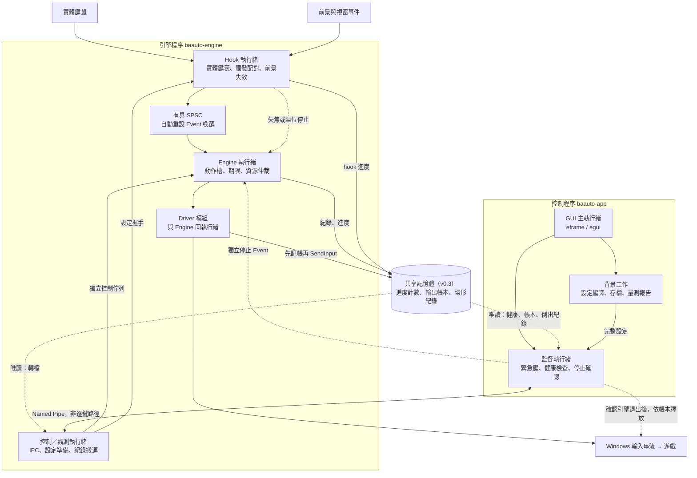
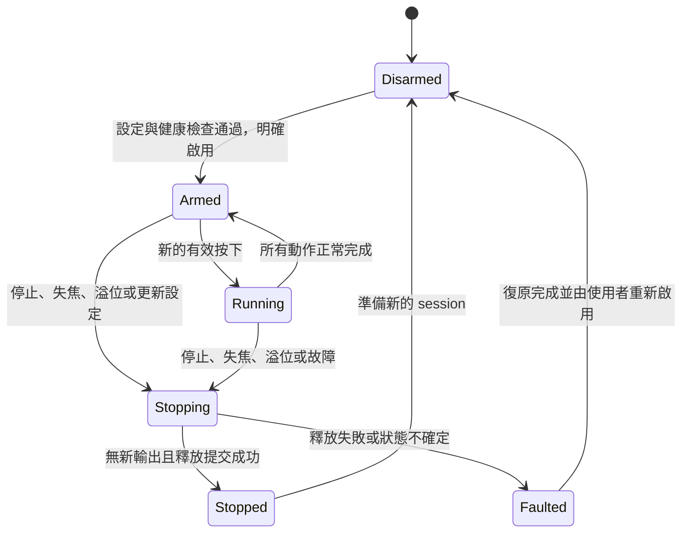

# BAauto-rs 融合架構 v0.4

日期：2026-10-10。狀態：實作設計，尚未建立或量測 Rust 引擎。v0.3 以 Astra v0.2 為主體，併入 Opus 版的四項機制；改動處標 **（v0.3）**。v0.4 依使用者需求改寫功能：拿掉拖曳、改成「牌鍵」，加入六人／十人模式與設定檔；改動處標 **（v0.4）**。2026-10-10 修訂：依使用者決定，設定分成「點位 JSON」（幾人＋點位按鍵清單）和「預設按鍵 JSON」（23 個預設按鍵＋時間）兩種檔，和 AHK 版的點位 JSON＋功能 JSON 一樣分開；牌鍵併進點位按鍵清單；手牌位置與範圍是這台電腦的設定。2026-10-11：遊戲一律當成全螢幕 16:9，不處理視窗化與黑邊。2026-10-12：依使用者決定移除晚到上限（`allowed_lateness`），所有動作晚到都照送；雙 Esc 的第二個 Esc 一定送出；超過20分鐘的驗收測試（8小時接收器、遊戲各1小時、足量樣本校準、A/B 實驗）不做，下文的長時間測試方法只供參考。

## v0.4 變更

| # | 變更 | 內容 | 影響章節 |
|---|---|---|---|
| 1 | 拿掉拖曳，改成牌鍵 | 按下牌鍵熱鍵時，看游標在手牌的第幾張上，就送那一格對應的按鍵（預設 1–5）；游標不在手牌上就不送。不再拖曳、不點目標 | §5、§9、§9A、§11 |
| 2 | 六人／十人模式 | 六人模式手牌 3 格，十人模式（制約解除決戰）手牌 5 格。模式寫在點位 JSON 裡，跟著點位檔走 | §9A、§10 |
| 3 | 手牌 UI 左右位置 | 對應遊戲選項「スキルカードUI位置」，兩邊都支援，預設右邊。和手牌範圍校準、每格按鍵一起存在這台電腦的設定（`settings.json`），所有點位檔共用 | §9A |
| 4 | 兩種 JSON | **點位 JSON**（每個關卡或 Boss 一份：六人／十人＋點位按鍵清單，每一筆的功能是「普通點位」或「牌鍵」）和**預設按鍵 JSON**（23 個預設按鍵的熱鍵與啟用＋時間，和 AHK 版的 function_keys.json 一樣）。兩種檔各自切換、各自存檔；點位內部資料整合，不再分 points／bindings 兩張表 | §9A、§10 |
| 5 | 介面 | 三欄介面（使用者選定）：上方兩列分別是點位 JSON（旁邊切六人／十人）和預設按鍵 JSON 的檔案按鈕＋完整路徑，各自一鍵切換；點位分頁是候選點位｜點位按鍵清單（功能欄：普通點位／牌鍵）｜詳細；不放說明段落、群組框、示意圖 | §13 |
| 6 | 遊戲畫面固定全螢幕 16:9 | 不處理視窗化、黑邊、內容區校準。座標一律相對遊戲所在螢幕的 0–1，換解析度不用重錄；AHK 舊座標語意相同，直接沿用。偵測到不是全螢幕 16:9 只在狀態列警告 | §9A、§10 |
| 7 | 任何路徑的 JSON | 任何位置（其他磁碟、網路磁碟、OneDrive、中日文、長路徑）的 JSON 都能開、能存；依內容判斷種類，可拖進視窗；舊檔轉換後存在原檔旁邊 | §10 |

目的：同時取得低輸入延遲、可預測的動作順序與可靠停止。遊戲能接受的最快節奏與每一步有效時間範圍，保留到 Windows／實際遊戲量測決定。

核心決策：**Rust 雙程序隔離故障；輸入監聽與引擎分執行緒；引擎獨占動作狀態及正常輸出；以事件與期限驅動；所有遊戲時序使用可校準設定。** GUI、檔案與程序間通訊不在逐次按鍵路徑上。

## v0.3 變更

| # | 併入項目 | 取代或補充 | 影響章節 |
|---|---|---|---|
| 1 | 先記後送的輸出帳本，放在共享記憶體 | 取代「Arm 前交出的候選鍵集合」作為復原時的主要釋放依據；候選集合降為帳本不可用時的備援 | §2、§3、§7 |
| 2 | 共享記憶體環形紀錄 | 取代「引擎 → 有界紀錄佇列 → 控制執行緒」；引擎直接寫入共享記憶體，控制執行緒與監督只讀 | §2、§3、§8、§12 |
| 3 | PresentMon＋DXGI 擷取的量測工具鏈 | 補充 §12C；錄影／人工標註保留為真值，用來驗證自動判定 | §11、§12、§13 |
| 4 | Hook 執行緒第一版就設 `THREAD_PRIORITY_TIME_CRITICAL` | §3「第一版不調優先權」的唯一例外；引擎優先權與尾段自旋仍是實驗項 | §1、§3、§12 |

延遲分段與「預計 vs 實際」時間點的圖解另見 [BAauto-rs 延遲時序](https://claude.ai/artifact/8SNATNR1dk3DYuoNkUWYcR)（數字為估計，實測後替換）。

## 1. 融合取捨

| 來源 | 保留 | 修正／捨棄 |
|---|---|---|
| 現有 AHK | 按住觸發、多動作、普通點位、JSON／MuMu 匯入 | 重複資料模型、字串反查、固定螢幕假設、不可取消的等待；**（v0.4）** 拖曳點位改成牌鍵 |
| Opus | 清楚的模組分工、SPSC、預編譯設定、純核心測試、錄點 GUI、事件紀錄；**（v0.3）** 先記後送帳本、共享記憶體環形紀錄、PresentMon／DXGI 量測、Hook 執行緒優先權 | 滿載丟事件繼續跑、看門狗與引擎同時輸出、panic 自動接續、無條件高優先權與自旋（Hook 執行緒除外，見 §3） |
| Astra | session/action 身分、停止確認、設定版本協定、程序級復原、明確量測 | 第一版不採複雜的可成長排程堆積；改用有上限的動作槽與期限掃描 |
| Kanata 概念 | 輸入與狀態處理解耦、平台封裝 | 不直接移植其重複／取消語意，不宣稱採用同樣效能調校就更快 |

雙程序增加啟動與控制複雜度，但不增加每一次實體按鍵的跨程序往返。選它的原因是引擎卡死時，能終止整個引擎並確認退出，再執行復原。單程序內另一條 watchdog 執行緒無法提供同樣的隔離邊界。

## 2. 程序與資料流



Driver 是引擎執行緒內的模組，不另開輸出執行緒，避免多一次佇列、喚醒與輸出取消競爭。只有可並行的準備與觀測工作離開引擎；所有共用游標／按鍵狀態的動作，由同一處仲裁。

**共享記憶體（v0.3）** 由控制程序在啟動引擎前建立，引擎程序開啟同一個具名區段。因為建立者是控制程序，引擎被終止後區段仍然存在，監督可以讀到最後狀態。版面為固定大小、`#[repr(C)]`，開頭是版本、大小與 session 標頭；內容只有三類：進度計數、輸出帳本、環形紀錄。標頭由控制程序在 Arm 前寫好；之後所有欄位只有引擎程序寫入，控制程序只讀；欄位用原子操作或單一寫入者的序號協定，不放指標、不放命令。它不取代停止 Event：原子變數可以跨程序共享資料，但不能喚醒等待中的執行緒。

## 3. 元件與實作

| 元件 | 實作方式 | 規則 |
|---|---|---|
| GUI | `eframe` / `egui` | 編輯、錄點、匯入、顯示狀態；不直接注入操作 |
| 監督 | 專用 OS 執行緒，`RegisterHotKey`、程序句柄、訊息與等待迴圈 | 不等待 GUI 繪圖或檔案寫入；緊急鍵註冊失敗時不可顯示已就緒 |
| Hook | `windows` crate 封裝 `WH_KEYBOARD_LL`、`WH_MOUSE_LL`，專用訊息迴圈；**（v0.3）** 執行緒優先權 `THREAD_PRIORITY_TIME_CRITICAL` | 固定大小資料、不等待佇列、不解析 JSON、不查檔案、不寫文字 log |
| 焦點追蹤 | `SetWinEventHook`；背景建立 PID/HWND/內容矩形快照 | 失焦先使目前 session 失效；輸出前再查前景。承認檢查與輸出間仍有窗口 |
| 通訊 | 每個生產者各自持有 `rtrb` SPSC；不可共用 Producer | 固定容量、事件序號、push 失敗進停止；不在 callback 重試 |
| 核心 | `std::thread`、`enum`、預配置動作槽 | 狀態單一擁有者；正常輸出只在這裡發生 |
| 計時 | QPC 整數時間軸、高解析度 waitable timer、`WaitForMultipleObjects` | 等最近期限或事件；延遲動作不呼叫阻塞式 Sleep |
| 輸出 | 預配置 `INPUT` 陣列、`SendInput`、自家 `dwExtraInfo` 標記 | 小批次、查回傳數量；不把成功注入當成遊戲成功 |
| IPC | Named Pipe + overlapped I/O，由控制執行緒處理 | 啟停、設定、狀態、日誌；不承載逐鍵輸入 |
| 設定 | `serde` / `serde_json`、schema 遷移、不可變編譯結果 | 停止狀態下協調切換版本，不任由兩端各自換快照 |
| 共享記憶體 **（v0.3）** | 控制程序 `CreateFileMappingW` 建立、兩端 `MapViewOfFile`；版本與大小標頭 | 引擎程序是唯一寫入者；不放指標或命令；版本不符就拒絕 Arm |
| 輸出帳本 **（v0.3）** | 共享記憶體中的按鍵位元集＋更新序號 | 送 Down 前先設位元，Up 成功提交後才清；永遠是「可能按住」的超集 |
| 記錄 | 固定大小二進位事件寫入共享記憶體環形區 **（v0.3）**，控制執行緒背景轉文字／CSV | 不在引擎同步寫檔；以序號偵測覆寫，遺失要計數並標記量測不完整；引擎被終止後監督仍可倒出 |
| 驗證 | 假時鐘／假輸出、`proptest`、小型 `Loom` 模型、Windows 故障注入 | 分開驗證純邏輯、同步協定、OS 和遊戲行為 |

`rtrb` 的固定容量與 wait-free 是資料結構性質，不是 Windows 保證在固定微秒內排程；事件值本身也必須避免配置記憶體。[rtrb 文件](https://docs.rs/rtrb/latest/rtrb/)

第一版不設 REALTIME、不綁 CPU、不啟用尾段自旋。先用一般優先權建立量測基準；提高優先權或短自旋各作為單獨實驗項，只有尾延遲改善且遊戲幀時間、CPU 與停止時間未惡化才保留。

**例外（v0.3）：Hook 執行緒第一版就設 `THREAD_PRIORITY_TIME_CRITICAL`。** 這條執行緒只做固定、很短的工作，提高優先權幾乎不增加 CPU 成本，卻能降低系統忙碌時 callback 來不及執行、累積逾時而被 Windows 移除的風險。程序優先權類別維持一般，所以它在一般類別裡是最高的執行緒優先權，不會進到 REALTIME 類別與系統工作競爭。這項設定本身仍列入 §12B 的對照實驗（一般 vs TIME_CRITICAL），確認對遊戲幀時間沒有副作用；引擎執行緒的優先權與尾段自旋照原規則，量測後才決定。

## 4. 輸入路徑與事件身分

每次有效按下產生 `(session_id, press_id)`。動作另有唯一 `action_id`；事件包含 `config_version`、`geometry_version`、來源序號及 QPC 時戳。

Hook 用固定索引表保存實體鍵狀態與「該次 Down 是否被攔截、綁定哪個 press」。KeyUp 對應原 press，不重新按當前設定解釋。修飾鍵鬆開使 chord 失效時，也要取消該 press，不能只等主鍵 Up。

同一實體鍵的 Down／Up 保留順序。普通 KeyUp 走有界 FIFO；不為了讓 Up 優先而把它移到尚未處理的 Down 前面。緊急停止、失焦與溢位有獨立停止路徑，不排在普通事件後面。

熱鍵自動重複政策寫在設定：重複動作只建立一個 action；單次送鍵是否接受 OS typematic 明確保留為選項，不能在移植時無聲改變語意。

自身合成事件用 injected flag 配合 `dwExtraInfo` 略過，不更新實體鍵表。其他程式注入事件預設不作為巨集觸發，避免回授；若需要互通，另作顯式設定與測試。

不是遊戲前景、未 armed、失效設定或未知狀態時，不啟動新 action。已攔截 Down 的鍵，其後續 Up 有配對處理，即使中途失焦也不能單純套新的攔截條件。

## 5. 引擎排程：有上限、無忙等、沒有補送洪流

第一版使用預配置 action slab，每個動作只保留下一個期限。每輪掃描所有有效槽找最近期限；最大槽數由設定編譯器限制，不在執行中擴容。這是有界 O(N) 基準，不先宣稱比 heap 快。只有量測顯示掃描占用明顯預算，才換成有容量上限、可刪除的 indexed heap。

引擎每輪：

1. 檢查 session 停止事件／監督程序存活，優先進停止狀態。
2. 處理有上限筆數或時間預算的輸入與控制事件；事件間仍可檢查停止。
3. 根據 action/session/設定版本驗證到期動作；仲裁共用資源。
4. 提交有上限的小批輸出，記錄 API 前後時戳及結果。
5. 更新 scheduler 進度與 action 實際進度；計算最近到期與健康檢查期限。
6. 有未處理事件／到期工作就進下一輪，否則進可中斷等待。

不能「無限清空輸入佇列再處理計時器」，也不能一次補送所有逾期動作。參數如佇列容量、每輪事件上限、最大批次大小屬於工程調校，與遊戲能接受的間距分開保存。

| 動作 | 時間語意 |
|---|---|
| 連點／重複技能 | 過期週期跳過並計數，不追趕；下一次仍遵守最小間距 |
| 鍵盤／滑鼠脈衝 | Down 與 Up 的最短持續時間分開設定；未證實可行前不壓成同批零間隔 |
| 牌鍵 **（v0.4）** | 按下當下判定游標所在的手牌格，送該格按鍵的一次脈衝（Down →`key_hold`→ Up）；之後不再看游標 |
| 多階段動作（連點的技能鍵→點擊、卡幀開牌） | 每階段從實際提交時間計算下一個最低間隔 |
| 雙 Esc（快／慢卡幀） | Esc，等該預設的固定間隔（`escape_gap_ms[0]`／`[1]`），再 Esc。第二個 Esc 一定送出，不設最晚期限；晚到就晚送，和原版 AHK 相同 |
| 普通點位 | 取得游標／左鍵資源後持有，Up／停止釋放；游標維持頻率可配置 |

對 min-gap 約束，下一步不能早於上一批成功提交結束時間加上設定間距。這限制的是程式注入時序，不代表遊戲消費時間已知。動作不因晚到而取消：取消只來自放開、停止、失焦、資源衝突或故障。只送一半的雙 Esc 會讓遊戲停在暫停畫面，比晚幾毫秒送出更糟。

`SendInput` 的批次只能合併語意允許同時提交的事件，例如普通點位的移動加按下；有必需等待的步驟一定分批。[SendInput 文件](https://learn.microsoft.com/en-us/windows/win32/api/winuser/nf-winuser-sendinput)

## 6. 喚醒與停止通道

**一般工作通知：auto-reset Event，唯一等待者是引擎。** 每次成功 enqueue 後呼叫 `SetEvent`。引擎處理到每輪上限後，如果還有待處理佇列就繼續跑，不能因事件已被消耗而直接睡眠。睡眠前重新檢查佇列；不手動 `ResetEvent` 這個通知。

這能避開「清空之後重設事件，剛好抹掉新通知」的常見競爭。多次通知可以合併，事件數量只以佇列為準。即使 producer 在空佇列檢查後、等待開始前才 SetEvent，訊號也會保留到等待者消耗。[SetEvent](https://learn.microsoft.com/en-us/windows/win32/api/synchapi/nf-synchapi-setevent)

**停止：每個 session 使用新的 manual-reset Event，設定後保持停止。** 多個執行緒與監督程序可以設定；本 session 內不清除、不復用。沒有空間可寫事件時，也能直接發停止。跨程序分享 kernel handle，不把普通 Rust AtomicBool 誤當跨程序通訊。

下一輪 session 只在完全停止、Hook 關閉新觸發、雙方接收新設定／句柄並完成握手後建立。控制命令帶遞增序號；只有明確的新 Arm 命令可以建立下一輪，舊的 Arm 或晚到回覆不能抵銷停止。狀態回覆也要帶 session，不可把上一輪的 Stopped 當成當前停止。

狀態進入 Stopped 後不再反覆等待舊的 signaled stop handle，以免忙迴圈；改等新的控制／關閉／健康事件。句柄只在所有使用方退出舊 wait-set 並確認後關閉。

## 7. 停止、取消與故障復原



正常 KeyUp 只取消該 press 的 action；全域停止使整個 session 失效。槽位重用還要驗證 action_id，不能讓舊期限命中新動作。

停止協定：禁止新動作 → 失效所有尚未執行的正常輸出 → 取消期限 → 引擎釋放自己持有的輸出 → 回覆 `Stopped(session)`。在 Stopping 狀態只允許釋放／必要清理，不允許新的技能、牌鍵、滑鼠 Down 或新的普通點位。

`Stopped` 的定義是：該 session 不再呼叫正常輸入 API，已知應釋放事件成功提交。它不保證遊戲已消費完全部事件。停止請求與正在執行的一次 SendInput 之間存在窗口；用小批次限制在途工作，不能宣稱從按下緊急鍵那一瞬間就完全沒有後續 OS 事件。

若心跳或停止確認逾時：

1. 監督執行緒先要求合作停止，禁止重新啟用。
2. 在已設定的復原期限內仍未確認，終止**引擎程序**。
3. 等待程序句柄確實進入已退出狀態，不以 TerminateProcess 呼叫返回當成退出完成。
4. 舊核心確定不能再輸出後，監督程序才讀取共享記憶體中該 session 的輸出帳本，對標記為可能按住的鍵送釋放，檢查結果並記錄 **（v0.3）**。帳本標頭的版本、session 或序號不一致時，才退回該 session 的候選輸出鍵集合。
5. 從共享記憶體倒出環形紀錄，作為這次故障的診斷資料 **（v0.3）**。
6. 保持 Faulted／Disarmed；不重播佇列、不自動恢復連點。

外部終止程序可能是非同步，必須等待退出。[TerminateProcess](https://learn.microsoft.com/en-us/windows/win32/api/processthreadsapi/nf-processthreadsapi-terminateprocess)

**輸出帳本（v0.3）是釋放的主要依據。** Driver 在呼叫 `SendInput` 送出 Down 之前，先以原子操作設定帳本中對應的位元並遞增序號；Up 成功提交後才清除。因為「先記」發生在系統呼叫之前，程序在任何一點被終止，帳本最多多記幾個其實沒按下的鍵，不會漏記真的按住的鍵。它是寫入順序保證的超集，不是可能過期的快照；短送或零送時位元保持設定，交給復原處理，和 §8「不重試整批」一致。

候選鍵集合仍在 Arm 前交給監督方，包含整輪所有可能送出的鍵，但降為帳本不可用時的備援。兩種釋放都是保守做法，都可能影響同名實體按鍵，因此復原後要求相關鍵放開再啟用。若 OS／權限阻止釋放、監督程序也崩潰或整個系統失去回應，不宣稱仍能保證復原。

引擎本身監聽控制程序死亡／連線失效並合作停止；這是另一層保護，不取代上述邊界。panic 的處理是停止並留下診斷，`Drop`／`catch_unwind` 只作輔助，不作程序死亡保證。

## 8. 健康檢查與錯誤處理

將三種訊號分開：

- `scheduler_progress`：引擎是否仍在處理迴圈。
- `action_progress`：該動作是否真的推進階段。
- `hook_loop_progress`：Hook 訊息迴圈是否能回覆探測。

三種進度計數都放在共享記憶體 **（v0.3）**，監督直接讀取，不經 Named Pipe；管線塞住或控制執行緒卡住時，健康判斷照常運作。

健康期限是排程器的獨立喚醒來源，所以完全閒置時仍能更新健康狀態；不再出現「空閒一直睡，卻被 250ms 看門狗當成卡住」。各逾時值在負載測試後定案，不沿用 100／250ms 就宣稱適合。

Hook 訊息迴圈活著，不代表 hook 仍掛著。`GetLastInputInfo` 也不能確診 hook 狀態。若加入 Raw Input 作為實體輸入對照，它只負責健康線索，不用來取代需要同步攔截的低階 hook；沒有實體輸入時不憑空判定失效。懷疑失效先停止，重新掛鉤只在 Disarmed 進行，並要求實體按鍵驗證。

| 情況 | 固定反應 |
|---|---|
| 輸入佇列滿／來源序號缺口 | 立即設定獨立停止訊號，session 作廢 |
| API 回傳短送／零送 | 不重試整個批次，因可能重複 Down；進 Faulted，保守釋放涉及鍵 |
| 環形紀錄被覆寫（讀取端落後）**（v0.3）** | 不阻塞引擎；以序號算出遺失筆數，標記量測資料不完整；基準測試可直接判該輪無效 |
| 焦點失去、視窗消失、內容矩形改變 | 取消當前動作；重新確認目標及幾何版本後才允許新的啟用 |
| 可選高解析度計時器不可用 | 明示降級狀態；未通過該模式校準的 timing profile 不可標示為已驗證 |
| IPC 中斷、監督程序死亡 | 引擎合作停止，不繼續無人監督輸出 |

## 9. 動作與資源語意

滑鼠資源是「游標位置＋左鍵」整體，不只一個左鍵布林值。普通點位持有資源期間，其他需要游標或點擊的動作不能插入；等待下一階段時引擎仍可處理事件與停止。**（v0.4）** 拖曳已移除，見 §9A。

- 普通點位獨占滑鼠資源；資源被佔用時，新的請求拒絕並顯示原因，不延後突然執行。
- 技能＋點擊是一個需要左鍵資源的序列；多鍵可同時啟用，由仲裁器逐次服務；不能先偷偷送技能鍵卻略過對應點擊。
- 純鍵盤動作（包含牌鍵）不需要滑鼠資源；若不涉及相同鍵或遊戲暫停狀態，可以和持有滑鼠資源的動作同時進行。
- geometry_version 變更時取消普通點位，不把進行中的動作改成新座標。

**額外處理 Esc：** 卡幀開牌與雙 Esc 都可能改變同一個遊戲暫停狀態。第一版把它們當成互斥資源；同時衝突的請求拒絕，不延後執行。多個一般 repeat 仍保留。這是相對原版「每個 card 各送 Esc」的明確行為調整，應在相容性驗收中展示。

Card 的正常鬆鍵是否補結束 Esc，依已開始的 phase 與 profile 決定，且必須仍是相同遊戲前景。失焦、緊急停止或狀態不確定時只清理按住的鍵，不盲目補一個會切換遊戲狀態的 Esc；UI 顯示需要人工確認暫停狀態。

實體輸入與合成輸入共用系統狀態，不能宣稱能完全隔離。啟用前要求相關輸出鍵釋放；執行中使用者按住相同鍵／左鍵時，進停止並要求放開後再啟用。清理仍可能影響實體按鍵狀態，列為實機必測項。實體游標移動的政策按模式寫清：普通點位保留維持位置的行為；牌鍵只在按下那一刻讀一次游標位置，之後使用者怎麼移動都不影響已送出的鍵。

## 9A. 牌鍵、六人／十人模式與手牌位置（v0.4）

**牌鍵**

- 牌鍵是點位 JSON 裡功能為「牌鍵」的項目，可以有多個（例如原本拖曳用的鍵）。格數看點位檔的模式；手牌位置、範圍、每格按鍵、自動重複政策是這台電腦的設定（`settings.json`），所有牌鍵、所有點位檔共用。
- 按下時，Hook 用 `GetCursorPos` 取得游標位置、換成遊戲畫面座標（遊戲所在螢幕的 0–1），放進 `TriggerDown`（§4）。引擎用目前設定檔的手牌版面判斷游標在第幾格。
- 在第 i 格 → 送第 i 格對應的按鍵（預設 1、2、3、4、5）一次脈衝：Down →`key_hold`→ Up。不移動游標、不點擊。
- 不在手牌矩形內 → 不送，回報「游標不在手牌上」，狀態列可以顯示。
- 判定只發生在按下那一刻。按住不放時的 OS 自動重複預設忽略（`settings.json` 的 `card_auto_repeat = Ignore`），可以改成跟著自動重複。
- 牌鍵不需要滑鼠資源。該格按鍵如果正被其他動作按住，這次請求拒絕並回報。
- 數字鍵在遊戲裡是直接施放還是要再選目標，由遊戲決定，不在本程式範圍。遊戲的按鍵對應如果改了，改 `settings.json` 的 `slot_keys`（5 個，六人只用前 3 個）。

**模式**

| 模式 | 編成 | 手牌格數 | 備註 |
|---|---|---|---|
| `six` 六人 | STRIKER 4＋SPECIAL 2 | 3 | 一般關卡、總力戰、戰術對抗等 |
| `ten` 十人 | STRIKER 6＋SPECIAL 4 | 5 | 制約解除決戰；COST 上限 20 |

- 模式寫在點位 JSON 裡。切換點位檔就切換模式，走 §10 的「停止 → 換設定 → 重新 Arm」。
- 手牌格數由模式決定：六人用 `slot_keys` 的前 3 個，十人用 5 個。
- 預設按鍵 JSON 不分六人／十人，23 個都照使用者設定。六人模式時 4、5 號相關的預設功能照常送鍵（遊戲裡沒有第 4、5 格就沒有作用），介面在狀態欄註明。

**手牌位置**

- 對應遊戲選項「スキルカードUI位置」：`card_ui_side: right | left`，預設 `right`，存在 `settings.json`。
- `settings.json` 存四組手牌矩形（六人右、六人左、十人右、十人左），都是遊戲畫面 0–1 座標。校準過的值覆蓋預設值；校準一次，所有點位檔都用。
- 格的順序預設是畫面上從左到右為第 1 到第 N 格（`slot_order: left_to_right`）。左邊版面的順序是否相同，要在遊戲裡確認；不同就改成 `right_to_left`。
- 手牌矩形切成 N 個等寬的格，格與格之間的縫算進最近的格，沒有死區；矩形外不算。

**預設值與校準**

- 初始估計（16:9 全螢幕、右邊）：六人 x 0.664–0.910、y 0.781–0.924，取自 AHK 版匯入 MuMu 設定時排除的技能卡區；十人假設右緣對齊、每格同寬，x 0.500–0.910、y 相同。左邊版面是右邊的鏡像（x → 1 − x）。
- 這些只是起點，**一定要在遊戲裡校準**：GUI 在遊戲畫面上畫出手牌框和格線，使用者拖拉對齊，或依序點第 1 格和最後一格的中心。校準結果存在這台電腦，不跟檔案走。
- 遊戲更新 UI 時要重新校準。換解析度不用（座標是 0–1）。遊戲換到別的螢幕或解析度改變，會遞增 `geometry_version`。

## 10. 設定、座標與資料遷移

不在運作中任意 ArcSwap 新設定。流程為：背景解析／編譯 → 停止舊 session → 等確認釋放 → Hook 與 Engine 安裝相同版本 → 雙方回覆版本 → 實體鍵回到放開狀態 → 明確 Arm 新 session。

快照可用 `Arc<CompiledConfig>` 共享不可變資料，但生命週期在停止邊界管理。舊設定的最後一次釋放放到背景，不讓大型 destructor 落在熱路徑。GUI 顯示快照可使用 ArcSwap；它不是跨元件更新協定。

**點位 JSON 與預設按鍵 JSON（v0.4，2026-10-10 修訂）**

- **點位 JSON**（`points/*.json`，schema `baauto-rs-points-v1`）：`name`、`mode`（`six`／`ten`）、`items`（點位按鍵清單）。每一筆有 `id`、`name`、`hotkey`、`function`；`function` 是 `point`（普通點位，另有 `x`、`y`：遊戲畫面上的 0–1 座標，介面顯示成目前解析度的像素）或 `card`（牌鍵，不需要座標）。每個關卡或 Boss 一份，預設附一個範例。
- **預設按鍵 JSON**（`keys/*.json`，schema `baauto-rs-keys-v1`）：`presets`（23 個預設按鍵的熱鍵與啟用狀態）、`timing`（TimingProfile）。和 AHK 版的 `function_keys.json` 同一個角色，預設附 `預設按鍵.json`。
- **這台電腦的設定**（`settings.json`，不跟檔案走）：手牌（`card_ui_side`、`slot_order`、四組手牌矩形、`slot_keys`、`card_auto_repeat`）、`EngineParams`、目前使用的點位檔和預設按鍵檔、開過的其他位置的檔案、介面偏好。
- 兩種 JSON 各自切換、各自存檔、各自有未儲存狀態；執行時用「目前的點位檔＋目前的預設按鍵檔＋settings.json 的手牌設定」一起編譯。切換任一種都走「停止 → 換設定 → 重新 Arm」。
- 衝突：預設按鍵彼此重複 → 雙方停用、預設按鍵檔不能存。點位檔的項目撞到預設按鍵或彼此重複 → 該項停用並回報原因，點位檔照樣可以存。
- 點位資料整合：一筆就是一個按鍵綁定，名稱、熱鍵、功能、座標放在一起；不再分成 points 與 bindings 兩張表，也不再重複存座標。
- 舊檔匯入：AHK 的功能 JSON → 預設按鍵 JSON；AHK 的點位 JSON → 點位 JSON（匯入時選六人或十人，預設六人），其中拖曳點位（`alternating`）轉成功能為牌鍵的項目，拖曳終點座標捨棄並寫進匯入報告。轉出的新檔預設存在原檔旁邊（檔名加「（新版）」），原檔不動。

**任何路徑的 JSON（2026-10-11 決定）**

- `points/`、`keys/` 只是新檔的預設位置。任何位置的 JSON 都要能開、能存：別的磁碟、網路磁碟（UNC `\\server\share`）、OneDrive、中文／日文與空白、超過 260 字元的長路徑。
- 開檔看內容判斷種類（`schema` 或欄位），不看資料夾或檔名。從哪一列按「開啟」都可以，會放到對的那一列；也可以把檔案拖進視窗。
- `settings.json` 存完整的絕對路徑（UTF-8）。比對前先正規化（大小寫、斜線、`GetFinalPathNameByHandleW` 取真實路徑），同一個檔不會開成兩個分頁；檔名相同但資料夾不同時，分頁加上資料夾名稱區分。
- 讀檔接受 UTF-8（有沒有 BOM 都可以）和有 BOM 的 UTF-16；副檔名大小寫不拘，`.json.json` 照樣接受。寫檔一律 UTF-8 無 BOM。
- 舊版 AHK 檔：轉出的新檔預設存在原檔旁邊，檔名加「（新版）」，使用者可以改位置；原檔不動。
- 存檔：暫存檔放在目標檔同一個資料夾，所以任何磁碟都能原子替換；`ReplaceFileW` 不支援的位置（部分網路磁碟）退回 `MoveFileExW`；沒有寫入權限或唯讀時回報，提示另存新檔。
- 開著的檔在外面被改過：存檔前比對修改時間與大小，被改過就問要覆蓋還是重新載入。啟動時記住的檔不見了（隨身碟拔掉、網路斷線）：分頁標「找不到檔案」，不自動移除，使用者可以重新指定或關閉。
- 程式碼裡路徑一律用 `PathBuf`／`OsString`，不轉成 `String` 再拼接；Windows API 用寬字元版本（`…W`）；長路徑交給標準函式庫處理（必要時自動加 `\\?\` 前綴）。

點位按鍵以 `PointId` 為唯一識別（點位檔內唯一的整數）。ID 使用已驗證唯一的穩定整數／新生 ID 策略，遷移時同步修正引用；清單不靠名稱＋熱鍵反查。

**遊戲畫面與座標（2026-10-11 決定）**

- 遊戲一律當成**全螢幕 16:9**。遊戲畫面＝遊戲視窗所在的整個螢幕（`MonitorFromWindow`）；不處理視窗化、黑邊，也沒有內容區校準。
- 所有座標（普通點位、手牌矩形、牌鍵判定時的游標）都是相對遊戲畫面的 0–1。所有 16:9 解析度共用同一組座標，換解析度不用重錄。
- AHK 舊檔的 0–1 座標本來就是相對整個鎖定螢幕，語意相同，匯入直接沿用，沒有「舊座標」狀態。只有絕對 x、y 又沒有基準尺寸的極舊格式，才請使用者告訴當時的解析度，不猜。
- 遊戲視窗矩形不等於螢幕矩形，或螢幕不是 16:9：狀態列警告「遊戲不是全螢幕 16:9，點位和牌鍵會不準」，不做補償。遊戲未找到時停用遊戲輸出，不自行退回任意螢幕。

DPI awareness 在建立任何視窗前設定；hook、錄點及 SendInput 虛擬桌面換算採一致實體像素（遊戲可能在副螢幕，負原點照樣要對）。包含負原點、多螢幕、DPI 變更與 HWND 重建測試。

儲存使用同目錄暫存檔、序列化驗證、flush／必要的同步、平台替換操作與備份；替換失敗保留舊檔並回報。讀者看到完整文件與斷電後資料耐久性是兩件事，實作時分別驗證。副檔名用 Path 處理，數值使用強型別；修復先前找到的表單選取、ID、Map 與 timing_ms 遺失問題。

## 11. 指令節奏：測可接受區間，而不先填一個最快數字

將「最快能發」與「最快仍被遊戲正確執行」分開。若目標是最高可靠頻率，對應的是最小可靠間距；對卡幀等序列，也要測最大允許間距。結果可能是分段的有效區域，不預設越慢一定越好。

TimingProfile 以動作類型、遊戲版本、視窗模式、FPS／同步設定、機器與測試條件作為識別；修改任何欄位後降為未驗證。

| 參數 | 量測目的 |
|---|---|
| `key_hold` | 鍵盤 Down→Up，多短仍會被讀到 |
| `mouse_hold` | 點擊 Down→Up 的可靠持續時間 |
| `key_to_click` | 選技能後，何時點擊才對應正確技能 |
| `repeat_period` | 一輪開始到下一輪開始的可靠週期 |
| `escape_gap` | 快／慢卡幀兩次 Esc 之間可成功的間隔 |

舊版 16／20／50ms 僅作「來源設定值」匯入，不冠上精準或已校準。也不把舊版 SetTimer(1) 換成 1ms repeat 就假設是相容行為。

設定驗證器檢查各階段最小時間、repeat period 與共享資源占用是否相容。例如已要求多段 hold／dwell，就不能承諾比它們總和更短的完整循環。對多動作負載同時報告單 action 與整體資源服務間隔。

## 12. 量測與驗收

### A. 純核心：先證明動作順序

假時鐘與假輸出驗證：每鍵合成持有次數有合法界線；任一時刻至多一個滑鼠交易擁有者；Stopped 後舊 session 不再輸出；快速鬆開重按不被舊事件影響；逾期不補送洪流；每輪工作有界；設定切換與滿載必有明確終止狀態。

Down／Up 不是要求任何時刻數量相等，而是持有期間允許差一；成功停止後必須無未結清持有。輸出失敗則標為 Faulted，不用內部帳本歸零冒充成功釋放。

### B. Windows：量軟體路徑與故障反應

記錄 `hook_enter`、`enqueue`、`engine_receive`、`deadline`、`send_begin`、`send_end`、`stop_request`、`stop_ack`，以及 session/action/版本、佇列深度、輸出回傳值。這些欄位以原始 QPC 整數寫進共享記憶體環形紀錄 **（v0.3）**，和 §12C 的 PresentMon、DXGI 時戳是同一個時鐘，不需要另做時鐘對齊。

報告 P50／P95／P99／P99.9、觀測最大值、樣本數與漏事件數；樣本不足時不展示不可信的高分位。這裡的延遲從 hook 觀測開始，並不包含鍵盤硬體到 Windows 前的全部時間。

負載情境包括遊戲空閒／高 GPU 負載／CPU 負載、多鍵交錯、頻繁切焦、視窗移動、GUI 持續操作、設定切換、紀錄讀取端落後、輸入洪流、sleep/resume。用故障注入覆蓋引擎 panic／abort、停止逾時、短送、IPC 斷線與 hook 重掛；終止引擎的案例要同時驗證帳本釋放與紀錄倒出 **（v0.3）**。

Hook 執行緒優先權對照 **（v0.3）**：同一組負載下比較一般與 TIME_CRITICAL 的 `hook_enter` 延遲分布、hook 逾時次數與遊戲幀時間；若 TIME_CRITICAL 讓遊戲幀時間變差，退回一般優先權。

以 ETW／WPA 區分引擎工作時間與已就緒卻未得到 CPU 的時間。臨時輸入接收器可以測 OS 接收，但不能取代遊戲成功率。

### C. 遊戲：取得有效操作率

觀測工具鏈 **（v0.3）**：

| 工具 | 量什麼 | 和引擎紀錄怎麼對齊 |
|---|---|---|
| [PresentMon](https://github.com/GameTechDev/PresentMon) | BlueArchive.exe 每一幀的開始時間與 `MsBetweenPresents`、`MsUntilDisplayed` 等幀時間 | 加 `--qpc_time` 輸出 `CPUStartQPC`，直接是 QPC 值；可畫出每個 `send_end` 落在哪一幀 |
| [DXGI Desktop Duplication](https://learn.microsoft.com/en-us/windows/win32/api/dxgi1_2/ns-dxgi1_2-dxgi_outdupl_frame_info) | 指定畫面區域何時出現變化，用來自動判定成功／失敗 | `LastPresentTime` 由系統以 QPC 取得；`send_end` → 畫面變化就是輸入到畫面的延遲 |
| 錄影／人工標註 | 真值 | 自動判定先和人工標註比對，誤判率達標後才用於大量掃描 |

DXGI 擷取需要視窗或無邊框模式。擷取與影像判定在控制程序或 `tools/bench` 執行，不進引擎程序。幀時間只是參考：遊戲不一定每幀只讀一次輸入，間距仍以下列實測為準。

1. 先建立可重複、可觀察成功／失敗的單一操作場景；資源不足、冷卻、不可施放等遊戲條件另行標記。
2. 從已觀察可成功的節奏開始，逐一掃描 hold、gap、period；先粗掃、再細掃邊界，不盲目假設單調而只做二分搜尋。
3. 重複相同試驗，混合不同開始相位與遊戲負載，避免剛好對上某一幀造成假象。
4. 記錄有效操作數、漏操作、誤操作、錯順序與重複操作；用錄影／人工標註建立第一版真值，再用 DXGI 自動判定擴大樣本 **（v0.3）**。
5. 單動作通過後，測多 repeat、牌鍵、普通點位與停止交錯；總輸入頻率會改變資源可用時間。牌鍵另外測：游標在格與格的縫上、手牌邊緣、左右兩種手牌位置、六人與十人兩種模式。
6. 選可靠區域內留有餘裕的設定，不直接採用偶爾成功的最快點。重新測試隔日、長時間與不同負載。

每組保存嘗試數、成功率、條件與失敗案例。零失敗不等於保證永不失敗；同時呈現樣本數與信賴區間。統計容許錯誤率與時序驗收門檻需在正式效能測試前定義，不能看到結果才調整標準。

正式選型優先順序：**無卡鍵／無取消後復活 → 操作正確率 → 尾延遲 → 有效操作率 → CPU 與遊戲幀時間成本。** 指令送得更多但漏操作更多，不算更快。

## 13. 實作順序與交付界線

1. `core`：動作、資源、session、時序型別、假時鐘與取消測試。
2. `win-input`：Hook → SPSC → Engine → Driver 的最小 Windows 路徑；先使用測試接收器。
3. `supervisor`：獨立停止、停止確認、程序退出後釋放；故障注入通過後才作長時間遊戲測試。
4. `compat`：AHK/MuMu 匯入、座標模式、UI bug 修復與功能對照。
5. `bench`：時序紀錄、PresentMon 匯入、DXGI 擷取判定 **（v0.3）**、遊戲校準 profile 與報告。
6. `app`：完整 GUI、錄點、狀態與報告入口；再逐項測優先權／自旋等優化。**（v0.4）** 三欄介面：上方兩列分別是點位 JSON（旁邊切六人／十人）和預設按鍵 JSON 的檔案按鈕（各自一鍵切換、新增、開啟、另存），旁邊是完整路徑；分頁為點位、預設按鍵、時間、紀錄，每頁都是清單＋右邊詳細；牌鍵併在點位按鍵清單裡，手牌設定在選到牌鍵時的右邊；手牌範圍可以直接輸入數字，也可以在遊戲畫面上校準；普通點位錄製。細節見 M6 任務檔。

```text
baauto-rs/
  crates/core/          純動作與期限邏輯
  crates/config/        型別、驗證、遷移與編譯
  crates/win-platform/  Hook、Event、Timer、Driver 的小型 unsafe 封裝
  crates/protocol/      IPC、session 與版本握手、共享記憶體版面（v0.3）
  bins/baauto-engine/   Hook／Engine／控制觀測執行緒
  bins/baauto-app/      GUI／監督／背景工作
  tools/bench/          接收器、紀錄分析、PresentMon 匯入、DXGI 擷取（v0.3）、校準報告
  tests/               重播、同步模型、故障注入、相容性
```

本版已決定程序分工、所有權、取消協定、滿載策略、設定切換與量測方法。尚未決定的是遊戲時序數值、容量調校、逾時門檻以及需要不需要優先權／自旋優化；這些由實作和實測補上，不以模型推測代替結果。

## API 依據

- [低階鍵盤 Hook](https://learn.microsoft.com/en-us/windows/win32/winmsg/lowlevelkeyboardproc)：callback／訊息迴圈與逾時限制。
- [Win32 Event](https://learn.microsoft.com/en-us/windows/win32/api/synchapi/nf-synchapi-createeventw)：跨程序句柄與重設語意。
- [多物件等待](https://learn.microsoft.com/en-us/windows/win32/api/synchapi/nf-synchapi-waitformultipleobjects)：事件與 timer 的共同等待。
- [高解析度等待計時器](https://learn.microsoft.com/en-us/windows/win32/api/synchapi/nf-synchapi-createwaitabletimerexw)、[QPC](https://learn.microsoft.com/en-us/windows/win32/sysinfo/acquiring-high-resolution-time-stamps)：喚醒通知與時間量測各自的用途。
- [RegisterHotKey](https://learn.microsoft.com/en-us/windows/win32/api/winuser/nf-winuser-registerhotkey)：獨立監督執行緒接收緊急鍵訊息。
- [CreateFileMappingW](https://learn.microsoft.com/en-us/windows/win32/api/winbase/nf-winbase-createfilemappingw)：控制程序建立、兩個程序共用的具名共享記憶體 **（v0.3）**。
- [SetThreadPriority](https://learn.microsoft.com/en-us/windows/win32/api/processthreadsapi/nf-processthreadsapi-setthreadpriority)：Hook 執行緒的 `THREAD_PRIORITY_TIME_CRITICAL` **（v0.3）**。
- [SendInput](https://learn.microsoft.com/en-us/windows/win32/api/winuser/nf-winuser-sendinput)：回傳值是實際插入的事件數；被 UIPI 擋下時不會從回傳值或 `GetLastError` 得知原因。
- [DXGI_OUTDUPL_FRAME_INFO](https://learn.microsoft.com/en-us/windows/win32/api/dxgi1_2/ns-dxgi1_2-dxgi_outdupl_frame_info)、[PresentMon](https://github.com/GameTechDev/PresentMon)：畫面變化與幀時間，皆可取得 QPC 時戳 **（v0.3）**。

以上是 API 能力依據；整體設計與預期收益是本案工程選擇，尚無 BAauto-rs 實測結果。
